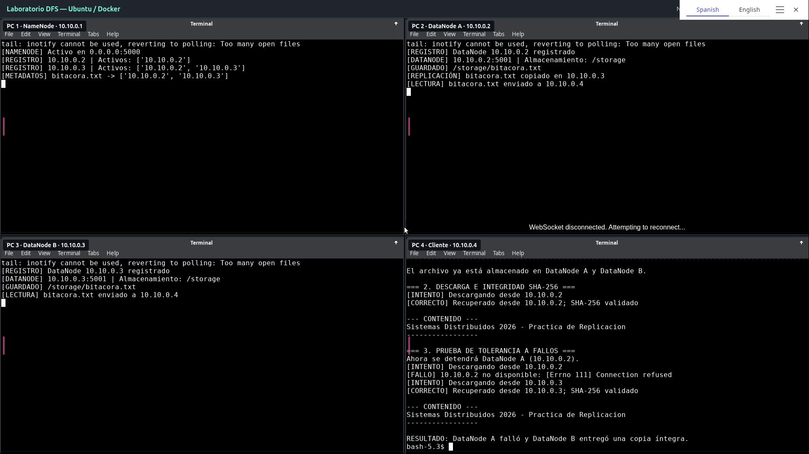

# Sistema de Archivos Distribuido Local

**Materia:** Sistemas Distribuidos  
**Equipo:** Equipo 4

Laboratorio de un Sistema de Archivos Distribuido (DFS) desarrollado en Python y ejecutado en cuatro contenedores Ubuntu con escritorio XFCE. Implementa metadatos centralizados, almacenamiento replicado, verificación de integridad SHA-256 y recuperación automática ante la caída de un nodo.

## Arquitectura

| Nodo | Contenedor | Dirección IP | Servicio | Puerto |
| :--- | :--- | :--- | :--- | :--- |
| PC 1 — NameNode | `dfs-namenode` | `10.10.0.1` | Metadatos y registro de nodos | `5000` |
| PC 2 — DataNode A | `dfs-datanode-a` | `10.10.0.2` | Almacenamiento primario | `5001` |
| PC 3 — DataNode B | `dfs-datanode-b` | `10.10.0.3` | Réplica y recuperación | `5001` |
| PC 4 — Cliente | `dfs-client` | `10.10.0.4` | CLI, descarga e integridad | — |

Los cuatro contenedores comparten la red Docker `dfs-net` (`10.10.0.0/24`). Los DataNodes pueden usar el mismo puerto porque tienen direcciones IP diferentes. Los escritorios se publican únicamente en `127.0.0.1`, en los puertos `3001`–`3004`.

## Estructura del repositorio

```text
.
├── dfs/                    # NameNode, DataNode, cliente y demo
├── panel/                  # Panel web con los cuatro escritorios
├── scripts/                # Inicio, apagado, acceso y grabación
├── evidencias/             # Video y captura de la demostración
├── .gitignore
└── README.md
```

Los directorios `config/`, `almacenamiento/`, `registros/` y `navegador-perfil/` se crean durante la ejecución y no se incluyen en Git.

## Requisitos

- Docker y permisos para ejecutarlo.
- Python 3.8 o superior.
- Navegador web.
- Para repetir la grabación: FFmpeg, Xvfb y Brave.

## Puesta en marcha

```bash
git clone git@github.com:Abb-968/dfs-local.git
cd dfs-local
chmod +x scripts/*.sh dfs/demo_cliente.sh
./scripts/iniciar_laboratorio.sh
```

El script crea la red, los cuatro contenedores y los directorios de ejecución. Si el usuario no pertenece al grupo `docker`, solicitará permisos mediante `sudo`.

Abrir el panel en **http://127.0.0.1:8080** o ejecutar:

```bash
./scripts/abrir_panel.sh
./scripts/abrir_terminales.sh
```

## Uso del cliente

Subir y replicar el archivo de prueba:

```bash
docker exec dfs-client python3 /dfs/client.py upload bitacora.txt \
  "Sistemas Distribuidos 2026 - Practica de Replicacion"
```

Descargar y validar el contenido:

```bash
docker exec dfs-client python3 /dfs/client.py download bitacora.txt
```

Los archivos se guardan localmente en:

```text
almacenamiento/nodo-a/bitacora.txt
almacenamiento/nodo-b/bitacora.txt
```

## Demostración y evidencias

La secuencia automatizada realiza la subida, comprueba la replicación, valida el hash, detiene DataNode A y descarga nuevamente desde DataNode B. Al finalizar, DataNode A se vuelve a iniciar.

```bash
./scripts/grabar_demostracion.sh
```

El video se genera en [`evidencias/demostracion_dfs.mp4`](evidencias/demostracion_dfs.mp4). La copia incluida tiene una duración de 73.5 segundos, resolución de 1920×1080 y codificación H.264.



## Resultados de las pruebas

| Prueba | Resultado | Evidencia |
| :--- | :--- | :--- |
| Conexión entre nodos | Pasa | Conexiones TCP correctas a los puertos `5000` y `5001` |
| Registro de metadatos | Pasa | NameNode registra `10.10.0.2` y `10.10.0.3` |
| Replicación activa | Pasa | `bitacora.txt` existe en ambos almacenamientos |
| Integridad SHA-256 | Pasa | Hash `98779f040679cdd7389feafc36b2b422845d404c20474a2188bb24570ec7af7e` |
| Tolerancia a fallos | Pasa | Tras detener A, el cliente recupera una copia íntegra desde B |

## Apagado

```bash
./scripts/detener_laboratorio.sh
```

Este comando detiene los contenedores y el panel sin eliminar los datos almacenados.

## Distribución de roles

| Rol | Integrante(s) | Equipo asignado | Responsabilidad principal |
| :--- | :--- | :--- | :--- |
| **Líder de Red & NameNode** | Javier Abraham Cruz | PC 1 (Master) | Configura la IP del servidor de metadatos y monitorea conexiones. |
| **Admin DataNode A** | Emily Ashanty May Alemán<br>Alondra Lissette Garcia Garcia | PC 2 (Almacenamiento 1) | Gestiona el DataNode A y monitorea lectura y escritura local. |
| **Admin DataNode B** | Braiam Augusto Hernandez Cen | PC 3 (Almacenamiento 2) | Gestiona el DataNode B y verifica la replicación de redundancia. |
| **Desarrollador Cliente & QA** | Abigail Hernandez Contreras | PC 4 (Cliente DFS) | Ejecuta peticiones CLI, audita SHA-256 y prueba tolerancia a fallos. |

## Nota sobre la infraestructura

Esta entrega sustituye las cuatro computadoras físicas descritas en la guía por cuatro contenedores en una red virtual. La demostración en vivo, las firmas y la validación de esta modalidad corresponden al equipo y al profesor.
